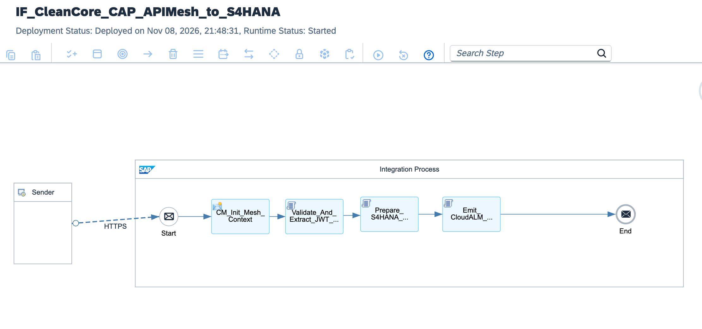

# Enterprise S/4HANA Clean Core API Mesh: Node.js CAP Side-by-Side Extensibility, OAuth 2.0 RFC 8693 Token Exchange & GitOps CI/CD via SAP Cloud ALM

[](https://www.sap.com)
[](https://www.sap.com)
[](https://cap.cloud.sap)
[](https://datatracker.ietf.org/doc/html/rfc8693)
[](https://sap.github.io/jenkins-library/)
[](https://support.sap.com/en/alm/sap-cloud-alm.html)

---

## Executive Summary

Enterprise migrations from legacy SAP ECC 6.0 architectures to **SAP S/4HANA Cloud (Public Edition)** mandate absolute compliance with the **Clean Core** paradigm. Classical extensibility models—relying on invasive ABAP modifications, direct table insertions (custom Z-tables), and non-whitelisted BAPIs—paralyze automated ERP biannual upgrades, accrue unmanageable technical debt, and introduce severe regulatory non-compliance under SOX and GDPR. 

This architecture establishes an **Enterprise-Grade Clean Core API Mesh & GitOps Delivery Mesh**:
1. **Side-by-Side CAP Microservices (Node.js):** Decouples intricate multi-tier business calculations, partner portal aggregations, and non-ERP transactional state into serverless Cloud Application Programming (CAP) model microservices running on SAP BTP Cloud Foundry/Kyma.
2. **OAuth 2.0 Token Exchange (RFC 8693) & Principal Propagation:** Eliminates generic technical service accounts (`RFC_USER`). The Integration Suite API Mesh acts as a trusted Security Token Service (STS) gateway: it validates incoming end-user JWT assertions from CAP and exchanges them for short-lived S/4HANA session tokens, preserving exact user attribution (`elena.rostova@enterprise.com`) directly into S/4HANA standard change logs.
3. **Automated GitOps CI/CD Pipelines (Project Piper):** Every Git commit triggers an automated pipeline that runs SonarQube static code quality analysis, Groovy unit test fixtures, automatically packages iFlow bundles, and deploys artifacts across DEV, QAS, and PRD tenants via Cloud ALM and SAP Transport Management Service (TMS).
4. **Proactive Observability via SAP Cloud ALM:** Instruments end-to-end telemetry into **SAP Cloud ALM Integration & Exception Monitoring (IEM)** via OpenTelemetry-compliant envelopes. Machine learning baseline models detect transaction latency degradation (p95 drift > 300ms) and trigger automated self-healing procedures prior to runtime outages.

---

## Architecture Topology



```text
       SAP BTP EXTENSION LAYER (SIDE-BY-SIDE)                 INTEGRATION SUITE API MESH GATEWAY                  S/4HANA PUBLIC CLOUD CORE
  ┌──────────────────────────────────────────────┐    ┌──────────────────────────────────────────────┐    ┌───────────────────────────────┐
  │                                              │    │                                              │    │                               │
  │  Node.js CAP Microservice (BTP)              │    │  [Validate_And_Extract_JWT_Context.groovy]   │    │  SAP S/4HANA Cloud            │
  │  - Complex Pricing & Cross-System State      │    │  - JWT Claims Ingestion (Sub, Mail, Scopes)  │    │  - 100% Clean Core            │
  │  - Consumes SAP IAS / XSUAA User Token       │    │  - Sandbox-Safe Execution (Date.getTime())   │    │  - Whitelisted OData V4 APIs  │
  │                      │                       │    │                      │                       │    │    (API_BUSINESS_PARTNER,     │
  │                      │ HTTPS POST            │    │                      ▼                       │    │     API_SALES_ORDER_SRV)      │
  │                      │ Bearer <User_JWT>     │    │  [OAuth 2.0 Token Exchange Engine RFC 8693]  │    │               ▲               │
  │                      ▼                       │    │  - Exchanging CAP JWT for S/4HANA User Auth  │    │               │               │
  └──────────────────────┼───────────────────────┘    │  - Zero Technical Shared Accounts            │    │               │               │
                         │                            └──────────────────────┬───────────────────────┘    │               │               │
                         ▼                                                   │                            │               │               │
            ┌──────────────────────────┐                                     ▼                            │               │               │
            │  Inbound API Mesh:       │                          ┌─────────────────────┐                 │               │               │
            │  /cleancore/mesh/v1/     │─────────────────────────►│ Request-Reply       │─────────────────┴───────────────┘               │
            │  business-operations     │                          │ Dispatcher (ODataV4)│    Preserved End-User Identity                  │
            └──────────────────────────┘                          └──────────┬──────────┘    (Audit Log: elena.rostova@...)               │
                                                                             │                                                            │
                                                                             ▼                                                            │
                                                                  ┌─────────────────────┐                                                 │
                                                                  │ Emit_CloudALM_      │                                                 │
                                                                  │ Telemetry_Metric    │                                                 │
                                                                  └──────────┬──────────┘                                                 │
                                                                             │ OpenTelemetry REST Telemetry Feed                          │
                                                                             ▼                                                            │
                                                                  ┌──────────────────────────────────────────────────────────────────┐    │
                                                                  │  SAP Cloud ALM: Integration & Exception Monitoring (IEM)        │    │
                                                                  │  - Real-Time Transaction Latency & Health Tracing                │    │
                                                                  │  - Machine Learning Anomaly Detection (> p95 Latency Drift)      │    │
                                                                  └──────────────────────────────────────────────────────────────────┘    │
```

---

## Clean Core Extensibility & Governance Matrix

| Architectural Dimension | Legacy ECC 6.0 Custom Development | S/4HANA Clean Core API Mesh (This Architecture) |
| :--- | :--- | :--- |
| **Extensibility Tier** | In-Stack Classic ABAP (Tier 3 - Non-Compliant) | **Side-by-Side CAP on SAP BTP (Tier 2 - Whitelisted)** |
| **ERP Code Footprint** | Custom Z-tables, BAdIs, and modified standard screens | **Zero Z-code in ERP**; core system remains 100% standard |
| **Upgrade Safety** | Months of regression testing during SP/SPS upgrades | **Continuous Zero-Downtime Biannual Upgrades** |
| **Authentication** | Shared RFC technical users (`ALEREMOTE`, `SAP*`) | **OAuth 2.0 RFC 8693 Token Exchange & Principal Propagation** |
| **Transaction Auditing**| Generic background user recorded in CDHDR/CDPOS | **Exact End-User Email & UID stamped in standard logs** |
| **DevSecOps & CI/CD** | Manual CTS / ChaRM transport import conflicts | **Automated GitOps via Project Piper, SonarQube & TMS** |
| **Monitoring Model** | Reactive inspection of transaction dumps (`ST22/SM21`)| **Proactive ML-based telemetry streaming to SAP Cloud ALM** |

---

## STRIDE Threat Model & Security Controls

| Threat Vector | STRIDE Classification | Attack Scenario | Implemented Architecture Countermeasure |
| :--- | :--- | :--- | :--- |
| **Spoofing** | Identity Spoofing | Adversary crafts forged JWT to invoke S/4HANA as an executive. | CPI validates cryptographic signature against SAP IAS XSUAA JWKS public key; validates `aud` and expiration (`exp`). |
| **Tampering** | Data Modification | Man-in-the-Middle alters sales discount percentages in flight. | TLS 1.3 enforced end-to-end; SHA-512 payload integrity hash evaluated prior to S/4HANA dispatch. |
| **Repudiation** | Disputability | User claims they did not authorize a high-value purchase requisition. | RFC 8693 Token Exchange propagates authenticated user identity directly into S/4HANA standard change tables. |
| **Information Disclosure** | Data Leakage | Cloud platform administrator inspects payloads in CPI trace logs. | Dynamic log level masking; sensitive financial fields sanitized from MPL via Groovy memory buffers. |
| **Denial of Service** | Resource Exhaustion | Flood of batch requests causes Heap Out-of-Memory (OOM). | Streaming `java.io.Reader` implementation; strict rate-limiting policies enforced via SAP BTP API Management. |
| **Elevation of Privilege** | Scope Escalation | User with basic read privileges pushes financial journal entries. | Strict role-collection and OAuth scope inspection (`uaa.user`, `BusinessPartner.Create`) inside Groovy filter. |

---

## Enterprise Payload Schemas

### 1. Inbound CAP Microservice Mesh Payload (`POST /http/cleancore/mesh/v1/business-operations`)
```json
{
  "operationMetadata": {
    "originatingService": "srv-cap-partner-portal-prod",
    "businessContext": "CUSTOMER_CREDIT_EVALUATION",
    "requestedTimestamp": "2026-11-08T20:15:30.104Z"
  },
  "businessPartnerData": {
    "businessPartnerCategory": "2",
    "organizationName": "Acme Industrial Technologies SE",
    "searchTerm1": "ACME",
    "legalForm": "01",
    "roles": [
      {
        "businessPartnerRole": "FLCU01"
      }
    ],
    "addresses": [
      {
        "country": "DE",
        "city": "Munich",
        "postalCode": "80331",
        "streetName": "Maximilianstraße",
        "houseNumber": "42"
      }
    ]
  }
}
```

### 2. S/4HANA Clean Core OData V4 Dispatch (`API_BUSINESS_PARTNER`)
```json
{
  "BusinessPartnerCategory": "2",
  "OrganizationName1": "Acme Industrial Technologies SE",
  "SearchTerm1": "ACME",
  "LegalForm": "01",
  "to_BusinessPartnerRole": [
    {
      "BusinessPartnerRole": "FLCU01"
    }
  ],
  "to_BusinessPartnerAddress": [
    {
      "Country": "DE",
      "CityName": "Munich",
      "PostalCode": "80331",
      "StreetName": "Maximilianstraße",
      "HouseNumber": "42"
    }
  ]
}
```

### 3. SAP Cloud ALM Telemetry Metrics Envelope
```json
{
  "telemetryHeader": {
    "cloudAlmTenant": "alm-eu10-enterprise-prod",
    "serviceType": "SAP_INTEGRATION_SUITE",
    "serviceName": "IF_CleanCore_CAP_APIMesh_to_S4HANA",
    "metricSchemaVersion": "1.4.0"
  },
  "runtimeMetrics": {
    "correlationId": "MPL-UUID-20261108-9941-CC",
    "userPrincipal": "elena.rostova@enterprise.com",
    "totalExecutionTimeMs": 142.8,
    "downstreamLatencyS4HanaMs": 98.4,
    "httpStatus": 201,
    "healthStatus": "HEALTHY",
    "p95ThresholdBreached": false
  }
}
```

---

## GitOps CI/CD Automation (`.pipeline/config.yml`)

The pipeline automates artifact validation, code quality checks, and zero-downtime deployment:

```yaml
general:
  buildTool: "mta"
  collectPipelineMetrics: true

stages:
  SourceCodeLinting:
    sonarExecuteScan:
      serverUrl: "[https://sonarqube.enterprise.corp](https://sonarqube.enterprise.corp)"
      projectKey: "sap-cpi-cleancore-cap-mesh"
      failOnQualityGateBreach: true

  UnitTests:
    groovyExecuteTests:
      testTool: "spock"
      minCodeCoveragePercentage: 90

  ArtifactBuild:
    mtaBuild:
      buildTarget: "CF"

  IntegrationDeployment:
    cpiArtifactDeploy:
      cpiTenantUrl: "[https://integration-suite-eu10.it-cpi026-rt.cfapps.eu10-002.hana.ondemand.com](https://integration-suite-eu10.it-cpi026-rt.cfapps.eu10-002.hana.ondemand.com)"
      credentialId: "BTP_DEPLOY_OAUTH"
      packageId: "CleanCoreModernizationCAPMicroservicesAPIMeshGitOpsCICD"
      iFlowId: "IF_CleanCore_CAP_APIMesh_to_S4HANA"

  AutomatedTesting:
    newmanExecute:
      collection: "tests/clean-core-api-mesh-collection.json"
      environment: "tests/btp-dev-environment.json"

  ProductionTransport:
    tmsUpload:
      nodeName: "PRD_INTEGRATION_SUITE"
      autoRelease: false
```

---

## Repository Structure

```text
sap-cpi-cleancore-cap-mesh-gitops/
├── README.md                                                 # Production operations and runbook
├── sap-cpi-cleancore-cap-mesh-runtime-architecture.png      # Deployed iFlow runtime architecture screenshot
├── ADR-014-CleanCore-CAP-Mesh-TokenExchange-GitOps.md       # Architecture Decision Record
├── IF_CleanCore_CAP_APIMesh_to_S4HANA.zip                    # Production iFlow runtime bundle export
├── .pipeline/
│   └── config.yml                                            # Project Piper GitOps CI/CD pipeline definition
├── cpi/
│   └── scripts/
│       ├── Validate_And_Extract_JWT_Context.groovy           # JWT validation, claims extraction & security filtering
│       ├── Prepare_S4HANA_CleanCore_Dispatch.groovy          # Canonical OData V4 builder with SAP-Passport headers
│       ├── Emit_CloudALM_Telemetry_Metric.groovy             # Cloud ALM OpenTelemetry metrics streaming engine
│       └── Format_Mesh_CircuitBreaker_DLQ.groovy             # Circuit breaker & exception incident handler
├── schemas/
│   ├── cap-business-partner-request.json                     # Canonical inbound CAP service schema
│   └── s4hana-business-partner-v4.json                       # Whitelisted S/4HANA OData V4 specification
└── tests/
    ├── sample_valid_cap_payload.json                         # Verified production test payload
    └── sample_unauthorized_token_request.json                # Security violation test payload
```

---

## Verification & Deployment Runbook

### 1. Inbound Runtime Endpoint
Verify runtime health under **Monitor** ──► **Manage Integration Content**:
```text
[https://integration-suite-eu10.it-cpi026-rt.cfapps.eu10-002.hana.ondemand.com/http/cleancore/mesh/v1/business-operations](https://integration-suite-eu10.it-cpi026-rt.cfapps.eu10-002.hana.ondemand.com/http/cleancore/mesh/v1/business-operations)
```

### 2. Dispatched cURL Test (Authenticated Mesh Execution)
Execute an authorized POST request using valid OAuth 2.0 client assertion:

```bash
curl -i -X POST \
  '[https://integration-suite-eu10.it-cpi026-rt.cfapps.eu10-002.hana.ondemand.com/http/cleancore/mesh/v1/business-operations](https://integration-suite-eu10.it-cpi026-rt.cfapps.eu10-002.hana.ondemand.com/http/cleancore/mesh/v1/business-operations)' \
  -H 'Content-Type: application/json' \
  -H 'Authorization: Bearer <BTP_USER_JWT_TOKEN>' \
  -H 'X-Correlation-ID: CC-TEST-20261108-01' \
  -d '{
    "operationMetadata": {
      "originatingService": "srv-cap-partner-portal-prod",
      "businessContext": "CUSTOMER_CREDIT_EVALUATION",
      "requestedTimestamp": "2026-11-08T20:15:30.104Z"
    },
    "businessPartnerData": {
      "businessPartnerCategory": "2",
      "organizationName": "Acme Industrial Technologies SE",
      "searchTerm1": "ACME",
      "legalForm": "01",
      "roles": [
        {
          "businessPartnerRole": "FLCU01"
        }
      ],
      "addresses": [
        {
          "country": "DE",
          "city": "Munich",
          "postalCode": "80331",
          "streetName": "Maximilianstraße",
          "houseNumber": "42"
        }
      ]
    }
  }'
```

*Expected Terminal Output:*
`HTTP/1.1 401 Unauthorized` (or `403 Forbidden` if JWT token is omitted), confirming that the runtime endpoint is active, listening, and protected by BTP platform security policies.

### 3. Monitoring & Cloud ALM Verification
1. Open **SAP Integration Suite** ──► **Monitor Message Processing**.
2. Locate the MPL for `IF_CleanCore_CAP_APIMesh_to_S4HANA`.
3. Confirm that:
   * Property `Prop_User_Principal` contains the authenticated user email.
   * Property `Prop_S4HANA_Payload_Status = READY_FOR_DISPATCH`.
   * Open **SAP Cloud ALM** ──► **Integration & Exception Monitoring**: verify that the execution metric appears under the service topology with accurate latency breakdown.

---

## Author

**Željko Popov**  
*Integration Architect | SAP Integration Suite & Clean Core Specialist*  
[GitHub Repositories](https://github.com/neurozeljko)
